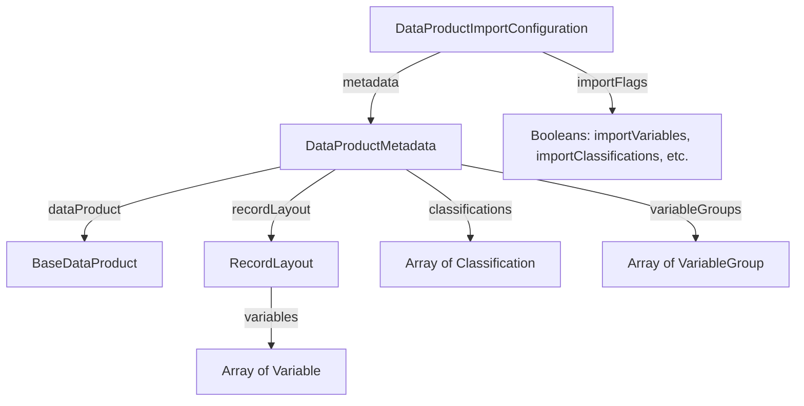

# Investigation: Native RDS JSON Metadata Import

This document summarizes findings from investigating the native RDS JSON metadata import capability, based on the `catalogManagement.swagger.json` specification and developer feedback.

---

## 1. API Endpoints

The native RDS JSON metadata import uses two management endpoints under the `management` path prefix:

### A. Retrieve Current JSON Metadata Configuration
- **Endpoint**: `GET /api/management/catalog/{uri}/product/{dataProductUri}/metadata/json`
- **Controller Method**: `getDataProductMetadataJson`
- **Response Schema**: `DataProductImportConfiguration`
- **Purpose**: Retrieves the full, editable configuration object describing all variables, classifications, and groups on the data product.

### B. Import / Apply JSON Metadata
- **Endpoint**: `POST /api/management/catalog/{uri}/product/{dataProductUri}/import`
- **Controller Method**: `importMetadata`
- **Request Body Schema**: `ImportConfiguration` (polymorphic base)
- **Response**: The ID of the started process (e.g. `"process-123"`).
- **Purpose**: Applies/imports the updated metadata configuration into the data product.

---

## 2. JSON Models & Hierarchy

Polymorphic imports require a discriminator property `importType`. For native metadata JSON import, the value is `"DATA_PRODUCT"`, mapping to the `DataProductImportConfiguration` schema on the server.

### Schema Hierarchy (`DataProductImportConfiguration`)

The full JSON schema structure is organized as follows:



### JSON Property Reference

#### 1. `DataProductImportConfiguration` (Top Level)
- `importType` (string, required): must be set to `"DATA_PRODUCT"`.
- `importProductDocumentation` (boolean): `true` to import product-level description/notes.
- `importVariableGroups` (boolean): `true` to import variable grouping.
- `importVariables` (boolean): `true` to import variables.
- `importClassifications` (boolean): `true` to import classifications.
- `metadata` (`DataProductMetadata`): The actual payload.

#### 2. `DataProductMetadata`
- `dataProduct` (`BaseDataProduct`): Literal metadata fields (e.g., notes, universe, citation).
- `recordLayout` (`RecordLayout`): The layout structure. Contains:
  - `variables` (Array of `Variable` schemas): Names, labels, descriptions, and classification URIs.
- `classifications` (Array of `Classification` schemas): Codelists and their codes.
- `variableGroups` (Array of `VariableGroup` schemas): Sub-group structures of variables.

---

## 3. Proposed SDK Implementation

To support this workflow, we can expose the following programmatic APIs in the toolkit:

```python
# 1. Retrieve the metadata import configuration
def get_metadata_import_config(self) -> dict[str, Any]:
    """Retrieve full DataProductImportConfiguration for JSON import."""
    path = f"management/catalog/{self.catalog_uri}/product/{self.uri}/metadata/json"
    response = self._catalog._server.api_request(path, method="GET")
    data = response.json()
    # Ensure discriminator is set for subsequent POST
    data["importType"] = "DATA_PRODUCT"
    return data

# 2. Trigger the import
def import_metadata_json(self, configuration: dict[str, Any]) -> MtnaRdsProcess:
    """Submit a DataProductImportConfiguration to import/apply metadata."""
    path = f"management/catalog/{self.catalog_uri}/product/{self.uri}/import"
    # Ensure discriminator is set
    configuration["importType"] = "DATA_PRODUCT"
    response = self._catalog._server.api_request(path, method="POST", body_json=configuration)
    pid = response.text  # or response.json() depending on return type
    return self._catalog._server.wait_for_process(pid)
```

---

## 4. Proposed CLI Commands

### Shell Interface
Inside a product context, add an `import-json` command:
```bash
rds(server):cat/prod> import-json path/to/metadata.json
```

### Direct Terminal Interface
Add a direct command to the main Typer CLI app:
```bash
dartfx-mtnards import-json <catalog-id> <product-id> <path/to/metadata.json>
```
